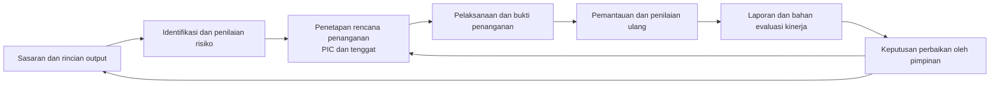

# Naskah PPT Inovasi MANRISK 2026

**Judul usulan:** MANRISK — Pengendalian Risiko untuk Mendukung Pencapaian Kinerja Kesehatan  
**Jenis inovasi:** Teknologi Sistem Informasi (Aplikasi)  
**Usulan kategori utama:** Evaluasi akuntabilitas kinerja internal, khusus pemanfaatan informasi risiko dalam evaluasi dan tindak lanjut kinerja. Kesesuaian kategori harus didukung bukti pemanfaatan aktual.  
**Sasaran pengakuan:** Percontohan Nasional, sesuai hasil verifikasi seluruh kriteria.  
**Format:** 16 slide utama dan lampiran untuk pendalaman juri.  
**Nama pada naskah:** MANRISK, mengikuti permintaan pengusul. Repositori menggunakan nama Manris. Samakan nama pada aplikasi, surat, bukti penggunaan, dan dokumen pengajuan.

## Petunjuk pengisian untuk pengusul

- Ganti seluruh `[ISI DATA: ...]` dengan data yang dapat ditelusuri. Jangan menampilkan placeholder pada paparan final.
- Bagian **Isi slide** masuk ke PPT. Bagian **Catatan penyaji** dan **Bukti** menjadi catatan presenter atau lampiran.
- Bukti implementasi kode mendukung penjelasan kemampuan aplikasi. Bukti tersebut tidak membuktikan fitur sudah aktif di produksi, jumlah pengguna, penghematan, atau peningkatan kinerja.
- Gunakan **realisasi**, **target**, dan **rencana** secara konsisten. Hapus klaim realisasi jika belum ada buktinya.
- PPT acuan mensyaratkan penggunaan oleh 90% satker sejenis dan 25% satker nonsejenis untuk kriteria Percontohan Nasional. Tetapkan populasi pembagi dan definisi penggunaan bersama tim penilai. Kesiapan replikasi tidak menggantikan bukti penggunaan.
- Tanggal acuan penyusunan: 10 November 2026. Jadwal penilaian di bawah mengikuti lampiran pengusul, bukan konfirmasi perubahan jadwal panitia.

---

## Slide 1 — MANRISK

### Isi slide

**Pengendalian Risiko untuk Mendukung Pencapaian Kinerja Kesehatan**

Informasi risiko, penanggung jawab, dan hasil penanganan sebagai dasar evaluasi kinerja.

- Pengusul: `[ISI DATA: nama satker dan unit utama]`
- Inovator/tim: `[ISI DATA: nama dan jabatan]`
- Mulai digunakan: `[ISI DATA: tanggal]`
- Pengajuan: Penilaian Inovasi Tahun 2026

### Catatan penyaji

“Pencapaian target kesehatan membutuhkan kemampuan mengenali hambatan dan menindaklanjutinya. MANRISK mendukung pekerjaan tersebut dengan menghubungkan pencatatan risiko, penanganan, pemantauan, dan bahan evaluasi dalam satu alur.”

**Visual:** Satu tangkapan layar aplikasi dengan data yang aman ditampilkan.

---

## Slide 2 — Masalah yang memengaruhi evaluasi kinerja

### Isi slide

| Kondisi awal yang perlu dibuktikan | Konsekuensi bagi organisasi |
|---|---|
| Data risiko tersebar dalam berkas antarunit | Konsolidasi dan pemeriksaan konsistensi membutuhkan pekerjaan berulang |
| Status penanganan terpisah dari profil risiko | Evaluator perlu mencari ulang informasi pelaksanaan |
| Penanggung jawab dan tenggat sulit ditelusuri | Tindak lanjut berisiko terlambat |
| Laporan belum cukup menjelaskan tindakan atas risiko | Pimpinan kekurangan dasar untuk menentukan prioritas perbaikan |

**Baseline satker:** `[ISI DATA: masalah paling material, periode, jumlah kasus, serta dampaknya terhadap pekerjaan/kinerja]`.

### Catatan penyaji

Gunakan satu masalah lokal yang nyata. Uraian kondisi awal sejalan dengan analisis kesenjangan internal, tetapi ukuran masalah harus berasal dari dokumen atau pengamatan satker pengusul.

**Bukti B01:** Peta proses lama, contoh dokumen, catatan waktu, dan hasil identifikasi masalah yang disahkan penanggung jawab.

---

## Slide 3 — Kontribusi MANRISK terhadap SAKIP

### Isi slide

**Kategori utama yang diusulkan: evaluasi akuntabilitas kinerja internal.**

MANRISK menyediakan bahan evaluasi mengenai risiko yang menghambat sasaran dan tindak lanjut pengendaliannya.

| Komponen SAKIP | Kontribusi yang ditawarkan | Bukti pemanfaatan |
|---|---|---|
| Perencanaan kinerja | Pengaitan risiko dengan sasaran atau rincian output | Risiko yang terkait sasaran/RO beserta dokumen rencananya |
| Pengukuran kinerja | Informasi risiko untuk membantu menjelaskan hambatan capaian | Analisis capaian yang menggunakan informasi risiko |
| Pelaporan kinerja | Bahan penjelasan masalah dan tindak lanjut | Bagian laporan kinerja yang merujuk hasil MANRISK |
| Evaluasi akuntabilitas kinerja internal | Bahan rekomendasi dan pemantauan tindak lanjut | Notulen evaluasi, rekomendasi, penanggung jawab, dan bukti tindak lanjut |

### Catatan penyaji

“Nilai tambah yang kami ajukan adalah penggunaan informasi risiko dalam evaluasi dan keputusan perbaikan kinerja.”

Evaluasi manajemen risiko tidak otomatis sama dengan evaluasi akuntabilitas kinerja internal. Tunjukkan dokumen yang menghubungkan keduanya. Tabel ini merupakan pemetaan usulan, bukan pengakuan bahwa aplikasi telah memenuhi seluruh komponen SAKIP atau mengukur realisasi IKU secara otomatis.

**Bukti B02:** Dokumen evaluasi kinerja yang memakai keluaran MANRISK dan contoh tindak lanjutnya.

**Rujukan:** Dasar pelaksanaan dalam PPT acuan mencantumkan [PermenPANRB Nomor 88 Tahun 2021](https://peraturan.bpk.go.id/Details/202221/permen-pan-rb-no-88-tahun-2021) dan [KMK HK.01.07/MENKES/2015/2024](https://jdih.kemkes.go.id/documents/keputusan-menteri-kesehatan-nomor-hk0107menkes20152024).

---

## Slide 4 — Alur pengendalian risiko dan pemanfaatannya

### Isi slide

**Pelaksana mencatat. Reviewer memeriksa. Pimpinan menetapkan tindak lanjut sesuai kewenangan.**

### Catatan penyaji

Diagram menggambarkan alur kerja organisasi yang didukung aplikasi. Keterkaitan dengan evaluasi kinerja dan keputusan pimpinan harus dibuktikan melalui praktik organisasi, tidak diasumsikan berlangsung otomatis di aplikasi.

**Bukti B03:** Demonstrasi satu contoh risiko dari sasaran/RO sampai hasil pemantauan dan penggunaannya dalam evaluasi.

---

## Slide 5 — Kriteria 1: Pembaharuan, orisinalitas, atau modifikasi

### Isi slide

**Kebaruan MANRISK terletak pada penggabungan pekerjaan yang sebelumnya terpisah.**

| Proses pembanding di satker | Pembaharuan yang ditawarkan MANRISK |
|---|---|
| Berkas risiko dikelola terpisah | Register terstruktur dengan hubungan ke organisasi dan sasaran/RO |
| Penanganan dicatat pada dokumen lain | Penanganan, PIC, tenggat, dan pelaporan progres dalam alur risiko |
| Penilaian periode berbeda dibandingkan manual | Riwayat profil dan hasil pemantauan untuk penelusuran perubahan |
| Bahan evaluasi disusun ulang dari banyak sumber | Kertas kerja dan laporan menggunakan data yang dikelola aplikasi |

**Pembeda utama:** kesinambungan antara risiko, tindakan, dan bahan evaluasi.

### Catatan penyaji

Kriteria membolehkan modifikasi dan adaptasi. Klaim kebaruan dibatasi pada perubahan proses yang dapat dibuktikan. Jangan mengklaim “pertama di Indonesia” tanpa pembandingan yang memadai.

Bantuan AI dapat ditambahkan sebagai pembaharuan pendukung apabila sudah aktif dan dapat didemonstrasikan. Manfaat inti tetap berada pada proses pengendalian risiko.

**Bukti B04:** Perbandingan proses/alat sebelumnya, alasan pengembangan, dan demonstrasi fungsi pembeda.

---

## Slide 6 — Kriteria 2: Memudahkan pelayanan

### Isi slide

**Pengguna dapat menelusuri pekerjaan risiko dan tindak lanjut dalam satu alur.**

- Form terstruktur membantu melengkapi informasi risiko.
- PIC dan tenggat menunjukkan siapa yang perlu bertindak.
- Status pekerjaan membantu penelusuran progres dan kekurangan laporan.
- Kertas kerja dan laporan mengurangi kebutuhan menyusun ulang data yang sama.

**Penerima layanan langsung:** operator satker, pemilik risiko, reviewer, dan pimpinan.

**Hasil penggunaan:** tahapan manual berkurang dari `[ISI DATA]` menjadi `[ISI DATA]`; kelengkapan pada pemeriksaan pertama berubah dari `[ISI DATA]%` menjadi `[ISI DATA]%`.

### Catatan penyaji

Konteks pelayanan pada usulan ini adalah layanan internal pengelolaan risiko dan penyediaan bahan evaluasi. Jelaskan hubungan tidak langsungnya dengan keberlangsungan program kesehatan.

**Bukti B05:** Peta proses sebelum–sesudah, uji penyelesaian tugas pengguna, dan rekap kelengkapan dokumen.

---

## Slide 7 — Kriteria 3: Mempercepat pelayanan

### Isi slide

**Estimasi waktu kerja aktif untuk konsolidasi laporan 20 risiko dari 4 unit turun dari 120 menjadi 60 menit.**

| Proses dan volume pekerjaan | Alur manual | MANRISK | Potensi pengurangan |
|---|---:|---:|---:|
| Menyiapkan satu profil risiko dengan satu rencana penanganan | 45 menit | 35 menit | **10 menit (22%)** |
| Menyusun satu laporan ringkas dari 20 risiko pada 4 unit | 120 menit | 60 menit | **60 menit (50%)** |
| Menelusuri status dan satu bukti penanganan | 15 menit | 7 menit | **8 menit (53%)** |

**Dasar penghematan laporan.** Pemilihan data dan penyiapan rekap diperkirakan turun dari 75 menjadi 15 menit. Pemeriksaan 20 risiko dan penyusunan ringkasan tetap dialokasikan 45 menit pada kedua alur.

*Simulasi berbasis asumsi durasi per langkah. Sumber data lengkap dan siap diolah pada kedua alur. Waktu tunggu data dan persetujuan berada di luar cakupan.*

### Catatan penyaji

“Kami memperkirakan waktu per langkah untuk keluaran yang sama. Pada contoh empat unit, waktu yang berkurang terutama berasal dari penyiapan dan penggabungan rekap. Pemeriksaan data dan penyusunan ringkasan tetap mendapat alokasi yang sama. Angka ini merupakan estimasi yang bisa diuji dengan pencatatan waktu.”

Asumsi pembanding adalah alur dengan berkas terpisah dari empat unit dan penggabungan manual. Data dan bukti yang sama sudah tersedia pada kedua alur. Operator MANRISK sudah terbiasa dengan alurnya dan mempunyai akses yang diperlukan. Perhitungan memakai formulir terstruktur, kalkulasi skor, filter dan ekspor laporan, serta tautan bukti yang sudah tercatat. Waktu untuk pelatihan awal, migrasi data, menunggu pihak lain, dan proses pengesahan berada di luar cakupan. Jika proses lama sudah memiliki rekap otomatis atau tautan bukti terpusat, sesuaikan estimasi alur manual dengan kondisi tersebut.

#### Rincian perhitungan untuk pendalaman

| Langkah | Manual (menit) | MANRISK (menit) | Dasar asumsi |
|---|---:|---:|---|
| **A. Satu profil risiko siap diajukan** | | | Satu risiko dengan satu rencana penanganan |
| Telaah bahan dan rumuskan risiko, penyebab, serta dampak | 20 | 20 | Alokasi penilaian substansi sama |
| Terapkan matriks, hitung dan periksa skor | 8 | 3 | Sistem menghitung skor dari input penilai. Operator memeriksa hasilnya |
| Catat rencana penanganan, PIC, tenggat, dan target | 12 | 9 | Asumsi alur manual menyalin data ke lembar penanganan. Form terstruktur menampung data yang terkait |
| Periksa kelengkapan dan simpan | 5 | 3 | Validasi field wajib membantu menemukan isian yang terlewat |
| **Total A** | **45** | **35** | **10 ÷ 45 ≈ 22%** |
| **B. Satu laporan ringkas siap diperiksa** | | | Satu periode, 4 unit × 5 risiko, format dan isi yang setara |
| Pilih data dan pastikan periode serta unit | 20 | 5 | Manual 4 berkas × 5 menit. Di MANRISK gunakan filter periode dan unit, lalu ekspor |
| Seragamkan dan gabungkan data ke format rekap | 55 | 10 | Manual 4 berkas × 10 menit untuk menyamakan format + 15 menit menggabungkan. Hasil ekspor tetap disesuaikan ke format rekap |
| Periksa cakupan, skor, dan data setiap risiko | 30 | 30 | 20 risiko × 1,5 menit pada kedua alur |
| Susun ringkasan dan periksa keluaran akhir | 15 | 15 | Ringkasan tetap disusun dan diperiksa petugas |
| **Total B** | **120** | **60** | **60 ÷ 120 = 50%** |
| **C. Satu status dan satu bukti penanganan ditemukan** | | | Satu risiko dan satu bukti yang sudah tersedia |
| Temukan risiko dan tugas penanganan | 5 | 2 | Filter dan daftar tugas membantu menemukan entri yang sesuai |
| Cocokkan status dan temukan dokumen terkait | 6 | 1 | Status dan tautan bukti tersedia pada detail tugas jika sudah dilaporkan |
| Buka bukti dan cocokkan dengan tindakan | 4 | 4 | Pemeriksaan bukti tetap dilakukan pada kedua alur |
| **Total C** | **15** | **7** | **8 ÷ 15 ≈ 53%** |

Dasar fungsi aplikasi tersedia pada bagian 6, 11, dan 13 panduan. Semua menit pada tabel adalah asumsi untuk skenario uji, termasuk asumsi alur manual. [Panduan penggunaan MANRISK](/Users/dikalaksana/Engineering/manris-v2/docs/panduan-penggunaan-manris-v2-fitur-aktif.html).

**Bukti B06 — Uji waktu sebelum paparan.** Pakai data, volume pekerjaan, dan daftar periksa mutu yang setara. Catat waktu sejak operator mulai membuka sumber sampai keluaran siap diperiksa. Ulangi pada beberapa pasangan kasus, bergantian memulai dengan alur manual atau MANRISK untuk mengurangi pengaruh hafalan. Catat jumlah kasus dan periode, lalu tampilkan median waktu aktif untuk masing-masing alur dan kelengkapan keluarannya. Simpan catatan waktu dan sampel hasil sebagai bukti. Setelah tersedia, ganti estimasi dengan hasil pengukuran.

---

## Slide 8 — Kriteria 4: Disebarluaskan dan mudah dikembangkan

### Isi slide

**Penyebarluasan mencakup pendampingan sampai satker mampu menyelesaikan pekerjaan.**

| Kegiatan yang sudah terlaksana | Cakupan | Hasil yang dibuktikan |
|---|---|---|
| Sosialisasi dan demonstrasi | `[ISI DATA: tanggal dan jumlah satker]` | Peserta memahami tujuan dan alur kerja |
| Pelatihan berbasis kasus | `[ISI DATA: tanggal dan peserta]` | Peserta menyelesaikan contoh profil dan penanganan |
| Pendampingan implementasi | `[ISI DATA: satker dan periode]` | Satker menghasilkan keluaran kerja aktual |
| Distribusi panduan dan dukungan | `[ISI DATA: media dan penerima]` | Pengguna memperoleh panduan dan kanal penyelesaian kendala |

**Satker yang menggunakan setelah pendampingan: `[ISI DATA]` satker.**

### Catatan penyaji

Repositori memuat panduan penggunaan dan ringkasan masukan pengguna. Dokumen tersebut perlu dilengkapi bukti distribusi serta pelaksanaan kegiatan. Undangan sosialisasi saja belum membuktikan penggunaan.

**Bukti B07:** Laporan sosialisasi, daftar hadir, materi, panduan yang berlaku, hasil praktik, dan tindak lanjut bantuan.

---

## Slide 9 — Kriteria 5: Bermanfaat

### Isi slide

**Manfaat ditunjukkan melalui perubahan hasil kerja dan pemanfaatannya dalam keputusan.**

| Tingkat manfaat | Indikator | Hasil aktual |
|---|---|---|
| Efisiensi pekerjaan | Jam kerja konsolidasi per periode | `[ISI DATA: sebelum dan sesudah]` |
| Mutu pengendalian | Penanganan jatuh tempo yang selesai dengan bukti terverifikasi | `[ISI DATA: pembilang, penyebut, dan persentase]` |
| Pemanfaatan manajerial | Keputusan evaluasi yang merujuk keluaran MANRISK | `[ISI DATA: jumlah dan contoh keputusan]` |
| Kinerja program terkait | Capaian indikator pada kasus yang ditindaklanjuti | `[ISI DATA: indikator, target, realisasi, dan periode]` |

**Lama pemanfaatan:** `[ISI DATA: tanggal mulai, tanggal akhir pengamatan, durasi, dan jumlah siklus]`.

### Catatan penyaji

“Manfaat terpenting kami tunjukkan melalui keputusan yang diambil dan hasil tindak lanjutnya.”

Jangan menyimpulkan aplikasi sendirian menyebabkan perubahan kinerja program. Terangkan perubahan sumber daya, kebijakan, dan faktor lain. Jam kerja yang dihemat merupakan kapasitas kerja yang tersedia kembali, bukan otomatis penghematan anggaran.

**Bukti B08:** Rekap indikator, dokumen keputusan, bukti pelaksanaan, data capaian, dan validasi pemilik proses.

---

## Slide 10 — Kriteria 6: Spesifik

### Isi slide

**Tujuan:** memperkuat evaluasi kinerja melalui informasi risiko dan tindak lanjut yang dapat ditelusuri.

**Sasaran:** `[ISI DATA: kelompok satker, pengguna, dan proses yang menjadi cakupan]`.

| Indikator keberhasilan | Target dan batas waktu |
|---|---|
| Risiko prioritas dengan PIC dan tenggat yang lengkap | `[ISI DATA]%` pada `[ISI DATA: tanggal]` |
| Penanganan jatuh tempo yang selesai dengan bukti terverifikasi | `[ISI DATA]%` pada `[ISI DATA: periode]` |
| Median waktu konsolidasi laporan | Maksimal `[ISI DATA]` jam pada `[ISI DATA: tanggal]` |
| Satker yang memakai keluaran MANRISK dalam evaluasi kinerja | `[ISI DATA]` dari `[ISI DATA]` satker pada `[ISI DATA: periode]` |

### Catatan penyaji

Target ditetapkan pemilik proses berdasarkan baseline. Definisikan risiko prioritas, pekerjaan selesai, bukti terverifikasi, serta populasi satker sebelum menghitung hasil. Target dan realisasi ditampilkan terpisah.

**Bukti B09:** Dokumen tujuan, cakupan, baseline, definisi indikator, target, dan penanggung jawab pengukuran.

---

## Slide 11 — Kriteria 7: Berkelanjutan

### Isi slide

**Keberlanjutan memerlukan penanggung jawab, anggaran, dan dukungan pengguna yang jelas.**

| Unsur | Komitmen atau kondisi yang perlu dibuktikan |
|---|---|
| Pemilik proses dan layanan | `[ISI DATA: unit, pejabat, dasar penugasan, dan status penetapan]` |
| Pemeliharaan dan dukungan | `[ISI DATA: tim pengelola, pengganti personel, helpdesk, dan standar layanan]` |
| Pembiayaan | `[ISI DATA: biaya tahunan, sumber anggaran, dan status persetujuan]` |
| Kelangsungan operasional | `[ISI DATA: pencadangan, hasil uji pemulihan, dan penanganan gangguan]` |
| Pengembangan | `[ISI DATA: prioritas 12 bulan, penanggung jawab, dan jadwal evaluasi]` |

**Umpan balik pengguna menjadi dasar perbaikan panduan dan alur kerja.**

### Catatan penyaji

Biaya perlu mencakup infrastruktur, pemeliharaan, pelatihan, dukungan, serta layanan AI jika digunakan. Bedakan komitmen yang sudah disahkan dengan rencana yang masih diajukan.

Ringkasan kuesioner internal menunjukkan kebutuhan panduan dan pendampingan. Gunakan sebagai dasar prioritas perbaikan, tanpa mengubahnya menjadi persentase kepuasan atau bukti keberhasilan operasional yang belum tersedia.

**Bukti B10:** Penugasan pengelola, rencana pembiayaan, SOP operasional, hasil uji pemulihan, dan rencana pengembangan.

---

## Slide 12 — Kriteria 8: Solusi atas akar masalah

### Isi slide

**MANRISK menata data risiko sejak pengisian profil hingga pelaporan dan penelusuran perubahan.**

| Masalah teridentifikasi | Akar masalah pada proses lama | Solusi MANRISK |
|---|---|---|
| Data tersebar dan sulit dikonsolidasikan | Unit mengelola risiko dalam berkas terpisah | Satu register risiko dengan filter unit dan periode serta ekspor untuk konsolidasi dan analisis |
| Kesalahan isian berpotensi terbawa ke laporan | Belum ada pemeriksaan saat pengisian | Validasi kolom wajib dan rentang nilai sebelum profil difinalisasi |
| Data sulit dibandingkan dan diolah | Format, kategori, dan skala penilaian belum seragam | Formulir terstruktur dengan kategori dan skala penilaian baku |
| Penyusunan profil memakan waktu | Pengisian dan penghitungan skor dikerjakan manual | Formulir memandu pengisian dan menghitung skor dari nilai probabilitas dan dampak yang dipilih petugas |
| Perubahan profil sulit ditelusuri | Perubahan belum tercatat dalam riwayat yang terhubung ke profil | Riwayat versi menampilkan profil aktif dan versi sebelumnya untuk perbandingan |

**Ukuran keberhasilan.** Waktu penyusunan profil, tingkat kelengkapan pada pemeriksaan pertama, dan kemampuan menelusuri profil ke versi sebelumnya.

### Catatan penyaji

“Kami menemukan bahwa data risiko sulit digabungkan karena tersebar dalam berkas dengan format berbeda. Kelengkapan dan rentang nilai belum diperiksa saat pengisian, sementara perubahan profil sulit dilacak. MANRISK menyatukan register dan menyeragamkan struktur data. Sistem memeriksa isian dan menghitung skor. Petugas tetap menilai ketepatan isi dan kesesuaiannya dengan bukti. Profil yang tersimpan dapat dipakai untuk rekap dan dibandingkan dengan versi sebelumnya.”

**Bukti B11.** Bawa satu profil aktual beserta contoh berkas lama, hasil ekspor periode yang sama, dan dua versi profil yang bisa dibandingkan. Dalam demo, tunjukkan respons formulir ketika kolom wajib kosong atau nilai di luar rentang. Gunakan data uji yang diberi label untuk demo validasi. Untuk angka efisiensi, rujuk estimasi atau hasil uji waktu pada Kriteria 3 sesuai statusnya.

---

## Slide 13 — Kriteria 9: Dapat diaplikasikan internal dan eksternal

### Isi slide

**Proses inti dapat digunakan lintas unit, dengan penyesuaian organisasi dan tata kelola.**

| Lingkup | Bentuk penggunaan atau replikasi |
|---|---|
| Internal satker | Operator, pemilik risiko, reviewer, dan pimpinan menjalankan peran masing-masing |
| Lintas satker sejenis | Penerapan alur yang sama dengan struktur organisasi dan pengguna setempat |
| Satker nonsejenis | Penyesuaian sasaran, contoh risiko, PIC, dan prosedur kerja sesuai mandat unit |
| Sistem pendukung | Pemanfaatan keluaran laporan atau akses ringkasan data yang diizinkan |

**Prasyarat replikasi:** penanggung jawab, kesesuaian proses, konfigurasi akses, pelatihan, dan dukungan operasional.

**Implementasi yang dapat dibuktikan:** `[ISI DATA: instansi/unit, tanggal mulai, ruang lingkup, dan keluaran]`.

### Catatan penyaji

Repositori memiliki pengelolaan organisasi, cakupan akses, serta antarmuka integrasi terbatas untuk ringkasan dashboard. Itu merupakan dasar teknis, bukan bukti integrasi telah digunakan instansi lain. Penerapan eksternal memerlukan penilaian kesesuaian dan hasil uji di unit penerima.

**Bukti B12:** Berita acara penggunaan/uji penerapan, konfigurasi yang relevan, dan keluaran unit penerima.

---

## Slide 14 — Kriteria 10: Percontohan Nasional

### Isi slide

**Usulan pengakuan ditopang oleh bukti penggunaan dan manfaat lintas satker.**

| Kelompok | Populasi yang disepakati | Satker pengguna terverifikasi | Cakupan aktual | Ambang dalam PPT acuan |
|---|---:|---:|---:|---:|
| Satker sejenis | `[ISI DATA]` | `[ISI DATA]` | `[ISI DATA]%` | 90% |
| Satker nonsejenis | `[ISI DATA]` | `[ISI DATA]` | `[ISI DATA]%` | 25% |

**Cakupan = jumlah satker pengguna terverifikasi ÷ jumlah satker dalam populasi kelompok × 100%.**

**Bukti penggunaan:** keluaran kerja aktual, rekam aktivitas, periode penggunaan, dan pengesahan unit penerima.

**Nilai yang dapat dicontoh:** alur pengendalian risiko, definisi indikator, panduan penerapan, dan metode pembuktian hasil.

### Catatan penyaji

PPT acuan menyebut penggunaan oleh 25% satker nonsejenis dan 90% satker sejenis. Definisi kelompok, populasi pembagi, serta bukti yang dianggap cukup perlu dikonfirmasi kepada tim penilai. Jangan menentukan pembagi hanya dari satker yang sudah bersedia memakai aplikasi.

Sebagai usulan definisi operasional, pengguna terverifikasi adalah satker yang menghasilkan keluaran kerja nyata pada periode penilaian. Definisi final mengikuti tim penilai. Akun terdaftar, kehadiran sosialisasi, akses demo, atau surat minat tidak otomatis membuktikan pemanfaatan.

Jika kedua ambang belum tercapai, isi slide sebagai **capaian saat ini dan rencana pemenuhan**. Jangan menyatakan sudah memenuhi Percontohan Nasional.

**Bukti B13:** Daftar populasi, klasifikasi, daftar pengguna, keluaran tiap satker, dan rekap perhitungan yang diperiksa.

---

## Slide 15 — Paket replikasi dan perluasan penggunaan

### Isi slide

**Unit penerima membutuhkan metode kerja dan pendampingan bersama aplikasi.**

Paket replikasi yang disiapkan:

1. SOP pengelolaan risiko dan pembagian peran.
2. Panduan penggunaan beserta contoh kasus yang sesuai unit penerima.
3. Konfigurasi organisasi, akun, akses, dan data awal.
4. Pelatihan serta pendampingan penyelesaian satu siklus pekerjaan.
5. Instrumen baseline dan pengukuran manfaat.
6. Dukungan operasional dan evaluasi setelah penerapan.

| Tahap rencana | Keluaran | Target |
|---|---|---|
| Persiapan | Penetapan unit penerima dan baseline | `[ISI DATA: tanggal dan jumlah satker]` |
| Penerapan | Profil risiko dan bukti penanganan aktual | `[ISI DATA: tanggal dan jumlah satker]` |
| Verifikasi | Bukti manfaat dan penggunaan yang diperiksa | `[ISI DATA: tanggal dan jumlah satker]` |

### Catatan penyaji

Tandai komponen paket yang sudah tersedia dan yang masih disusun. Tetapkan jadwal yang realistis terhadap batas penilaian. Rencana perluasan merupakan bukti arah keberlanjutan, bukan pengganti realisasi cakupan penggunaan.

**Bukti B14:** Paket replikasi, rencana kerja, penanggung jawab, dan berita acara pendampingan.

---

## Slide 16 — Usulan pengakuan dan pemanfaatan

### Isi slide

**MANRISK menghubungkan informasi risiko dengan tindakan dan bahan evaluasi kinerja.**

- Perubahan proses: `[ISI DATA: pembaharuan paling penting yang terbukti]`.
- Manfaat terukur: `[ISI DATA: hasil terkuat beserta periode]`.
- Penggunaan lintas satker: `[ISI DATA: cakupan sejenis dan nonsejenis]`.
- Keberlanjutan: `[ISI DATA: penanggung jawab dan dukungan yang telah ditetapkan]`.

**Usulan:** pengakuan MANRISK sebagai inovasi dan penilaian untuk kategori Percontohan Nasional berdasarkan verifikasi seluruh kriteria.

### Catatan penyaji

“Kami mengajukan MANRISK sebagai cara kerja pengendalian risiko yang dapat diperiksa hasilnya dan diterapkan unit lain. Kami menyiapkan bukti perubahan proses, manfaat, penggunaan, dan pengelolaannya sebagai dasar penilaian.”

Jika seluruh bukti dan ambang telah terverifikasi, gunakan penutup lebih tegas: “Berdasarkan bukti pemenuhan sepuluh kriteria tersebut, kami mengusulkan penetapan MANRISK sebagai Inovasi Percontohan Nasional.”

---

## Lampiran A — Matriks bukti sepuluh kriteria

| Kriteria | Bukti utama | Pertanyaan yang harus terjawab |
|---|---|---|
| 1. Pembaharuan | B01, B04 | Perubahan apa yang membedakannya dari proses sebelumnya? |
| 2. Memudahkan | B05 | Tahapan atau kesulitan apa yang berkurang bagi pengguna? |
| 3. Mempercepat | B06 | Berapa waktu yang berkurang dengan mutu keluaran setara? |
| 4. Disebarluaskan | B07 | Siapa yang menerima pendampingan dan apa hasilnya? |
| 5. Bermanfaat | B02, B08 | Hasil kerja atau keputusan apa yang berubah, dan selama berapa lama? |
| 6. Spesifik | B09 | Siapa sasarannya, apa indikatornya, dan kapan target tercapai? |
| 7. Berkelanjutan | B10 | Siapa mengelola, membiayai, dan memelihara layanan? |
| 8. Solusi masalah | B03, B11 | Bagaimana akar masalah ditangani dan hasilnya diverifikasi? |
| 9. Internal/eksternal | B12 | Apakah unit penerima dapat menjalankan prosesnya? |
| 10. Percontohan Nasional | B13, B14 | Apakah cakupan, manfaat, dan penerapan lintas satker terbukti? |

Untuk setiap bukti, catat nama dokumen, tanggal, pemilik, lokasi penyimpanan, periode data, dan pemeriksa. Hapus atau samarkan informasi yang tidak diperlukan untuk penilaian.

## Lampiran B — Jawaban untuk pendalaman juri

### “Apa inovasinya jika aplikasi manajemen risiko sudah ada?”

“Pembaharuan yang kami ajukan adalah perubahan proses di lingkungan penerapan. MANRISK menghubungkan risiko, penanganan, pemantauan, dan bahan evaluasi. Kami membuktikan perbedaannya melalui perbandingan proses serta hasil penggunaan. Pengakuan yang kami minta sesuai ruang pembaharuan/modifikasi dalam kriteria penilaian.”

### “Apa hubungannya dengan SAKIP?”

“Informasi risiko menjadi bahan menjelaskan hambatan capaian dan merumuskan tindak lanjut evaluasi. Pada `[ISI DATA: dokumen/periode]`, keluaran MANRISK digunakan untuk `[ISI DATA: keputusan]`, dengan hasil `[ISI DATA: tindak lanjut]`.”

Jika belum ada dokumen pemanfaatan tersebut, hubungan dengan SAKIP masih merupakan rancangan kontribusi dan perlu dibuktikan.

### “Apakah aplikasi benar-benar mempercepat pekerjaan?”

**Jika masih memakai simulasi.** “Estimasi untuk rekap 20 risiko dari empat unit adalah 120 menit dengan penggabungan manual dan 60 menit dengan MANRISK. Selisih 60 menit berasal dari penyiapan rekap. Pemeriksaan risiko dan penyusunan ringkasan tetap dialokasikan 45 menit di kedua alur.”

**Jika sudah diukur.** “Kami membandingkan `[ISI DATA: jumlah]` pekerjaan sebanding pada periode `[ISI DATA]`. Median waktu berubah dari `[ISI DATA]` menjadi `[ISI DATA]`, dengan pemeriksaan kualitas melalui `[ISI DATA]`. Catatan pengukurannya tersedia.”

### “Apakah selesai melapor berarti risiko sudah turun?”

“Pelaporan menunjukkan tersedianya informasi pelaksanaan. Penurunan risiko diperiksa melalui hasil pemantauan dan penilaian ulang atas kondisi aktual. Target penurunan, laporan progres, tindakan selesai, dan hasil aktual dicatat sebagai hal yang berbeda.”

### “Apakah manfaatnya sudah dirasakan masyarakat?”

“Manfaat langsung yang kami ukur adalah mutu pengendalian dan evaluasi internal. Kontribusi terhadap program kesehatan kami tunjukkan melalui kasus `[ISI DATA]` beserta capaian terkait. Klaim dampak kesehatan yang lebih jauh memerlukan pengukuran tersendiri.”

### “Bagaimana keamanan data dan penggunaan AI?”

“Aplikasi memiliki pengaturan akses berdasarkan pengguna dan organisasi. Penggunaan AI mengikuti izin penggunaan data dan pemeriksaan hasil oleh petugas. Bukti pengujian serta konfigurasi lingkungan yang digunakan adalah `[ISI DATA]`.”

Jangan menyatakan seluruh kontrol produksi telah terverifikasi hanya dari keberadaan kode. Dokumentasi keamanan internal menyatakan konfigurasi akun penyedia AI dan deployment perlu diverifikasi tersendiri. Jangan mengklaim sertifikasi keamanan, zero retention, atau bahwa semua data tetap berada di lingkungan internal tanpa bukti.

### “Apa yang terjadi jika pengembang pindah atau AI tidak tersedia?”

“Keberlanjutan ditopang oleh `[ISI DATA: tim/unit pengelola]`, dokumentasi, pembiayaan, dan dukungan operasional. Alur inti pengelolaan risiko dapat dikerjakan melalui pengisian dan penilaian petugas. Hasil uji operasional tanpa bantuan AI ditunjukkan pada `[ISI DATA]`.”

### “Apakah sudah layak disebut Percontohan Nasional?”

“Cakupan terverifikasi adalah `[ISI DATA]%` satker sejenis dan `[ISI DATA]%` satker nonsejenis, dengan populasi `[ISI DATA]`. Kami menyertakan bukti penggunaan serta hasilnya. Status Percontohan Nasional kami ajukan sesuai hasil verifikasi tim penilai.”

Jika belum memenuhi ambang, nyatakan kekurangannya dan rencana pemenuhan. Paparan persuasif tidak dapat menggantikan persyaratan penggunaan.

### “Apakah satu aplikasi otomatis menaikkan nilai SAKIP 16 poin?”

“Penilaian mengikuti komponen dan bukti yang diakui evaluator. Angka kontribusi 16 dalam PPT acuan menjelaskan inovasi percontohan nasional pada semua komponen. Angka itu tidak dapat dijanjikan sebagai kenaikan otomatis dari satu aplikasi.”

## Lampiran C — Administrasi dan jadwal menurut PPT acuan

| Tahap | Jadwal/keterangan dalam lampiran |
|---|---|
| Identifikasi dan input SIAPIN | 4–10 November 2026 |
| Seleksi awal | 18–20 November 2026, paparan menjelaskan sepuluh kriteria |
| Penilaian akhir | Februari 2027, oleh Itjen, Roren, dan Eselon I |
| Rekomendasi/pengakuan | Surat Direktur Jenderal Penanggulangan Penyakit |
| Pemanfaatan penetapan | Evaluasi SAKIP 2026 pada Maret 2027 dan Semester I 2027 pada Juli–Agustus 2027 |

Catatan kelengkapan:

- Pada tanggal penyusunan, 10 November 2026 merupakan hari terakhir input menurut jadwal lampiran. Periksa pengumuman panitia jika ada perubahan.
- Lampiran meminta satu usulan untuk inovasi dengan kategori yang sama. Tetapkan kategori utama berdasarkan bukti pemanfaatan terkuat.
- Slide 6 menyebut kesesuaian periode evaluasi atau riwayat belum pernah diusulkan pada tahun sebelumnya dengan notasi Y-2. Siapkan kronologi pemanfaatan dan riwayat pengajuan. Penafsiran operasional Y-2 mengikuti panitia.
- Slide 6 mencantumkan HKI, paten, penghargaan, serta penetapan minimal oleh Eselon I atau atas nama Eselon I setelah penilaian. Cantumkan status dokumen yang benar-benar dimiliki. Jangan menganggap semua bentuk HKI/paten/penghargaan wajib dimiliki sekaligus tanpa penjelasan panitia.
- Penetapan merupakan hasil proses penilaian. Jangan menampilkan surat yang masih direncanakan sebagai pengakuan yang sudah diperoleh.
- Ketentuan usia dokumen satu/lima tahun pada tabel nilai SAKIP perlu dibaca dalam konteks komponen dan dokumen yang dinilai. Ketentuan itu tidak otomatis berarti aplikasi wajib berusia lima tahun.
- Kategori dalam lampiran: kriteria 1–9 untuk “Dapat dihargai” bernilai 0,5, kriteria 1–10 untuk “Percontohan Nasional” bernilai 1, dan tidak memenuhi kriteria bernilai 0. Penetapan nilai tetap dilakukan penilai.

## Lampiran D — Skenario demonstrasi singkat

Gunakan satu kasus nyata yang aman ditampilkan atau kasus sintetis yang diberi label jelas.

1. Buka profil risiko dan tunjukkan hubungan dengan sasaran/RO.
2. Tunjukkan penanganan, PIC, dan tenggatnya.
3. Buka bukti pelaksanaan serta hasil pemantauan.
4. Tunjukkan keluaran laporan yang terkait.
5. Tunjukkan dokumen evaluasi kinerja yang menggunakan hasil tersebut.

Siapkan salinan layar dan dokumen jika koneksi bermasalah. Jangan menampilkan data sintetis sebagai bukti manfaat aktual.

## Catatan sumber dan batas verifikasi

Sumber utama kriteria, ambang adopsi, jadwal, dan mekanisme penilaian adalah PPT lokal “Penilaian Inovasi Tahun 2026.pptx”, 15 slide, dari pengusul. Teks SmartArt slide 6 juga diperiksa.

Dasar kemampuan produk diperiksa dari repositori, termasuk registrasi rute backend, entitas risiko, modul pemantauan, evaluasi, laporan, organisasi, dan panduan penggunaan. Pemeriksaan bersifat statis. Tidak dilakukan uji aplikasi produksi atau verifikasi data penggunaan.

Sumber internal yang relevan:

- [PPT acuan](/Users/dikalaksana/Downloads/Penilaian%20Inovasi%20Tahun%202026.pptx)
- [PRD](/Users/dikalaksana/Engineering/manris-v2/prd.md), dipakai untuk konteks tujuan produk, bukan sebagai bukti semua fitur telah operasional.
- [Analisis kesenjangan](/Users/dikalaksana/Engineering/manris-v2/docs/business-gap-analysis.md), untuk rumusan masalah yang perlu dilengkapi baseline pengusul.
- [Ringkasan kuesioner](/Users/dikalaksana/Engineering/manris-v2/docs/manris-questionnaire-analysis-report.md), untuk kebutuhan panduan dan pendampingan. Dokumen tidak menyediakan dasar angka kepuasan pada naskah ini.
- [Panduan fitur aktif](/Users/dikalaksana/Engineering/manris-v2/docs/panduan-penggunaan-manris-v2-fitur-aktif.html), dengan status fitur mengikuti waktu penyusunan panduan dan perlu disesuaikan lingkungan demonstrasi.
- [Rute aplikasi](/Users/dikalaksana/Engineering/manris-v2/backend/cmd/server/main.go) dan [entitas risiko](/Users/dikalaksana/Engineering/manris-v2/backend/internal/domain/entity/risk.go).
- [Status pengamanan dan rilis AI](/Users/dikalaksana/Engineering/manris-v2/docs/security/ai-privacy-release.md), untuk membatasi klaim yang belum diverifikasi pada lingkungan produksi.
- [Integrasi ringkasan dashboard](/Users/dikalaksana/Engineering/manris-v2/docs/api-key-heatmap.md), untuk dasar kemampuan integrasi terbatas, bukan bukti integrasi aktual.

Dokumen rencana fitur tidak diperlakukan sebagai bukti implementasi. Naskah tidak mengklaim sertifikasi ISO, keunggulan pertama secara nasional, peningkatan otomatis nilai SAKIP, keamanan absolut, atau manfaat kuantitatif yang belum diukur.
