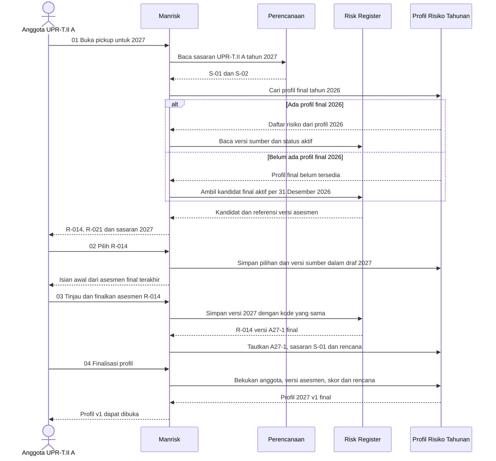
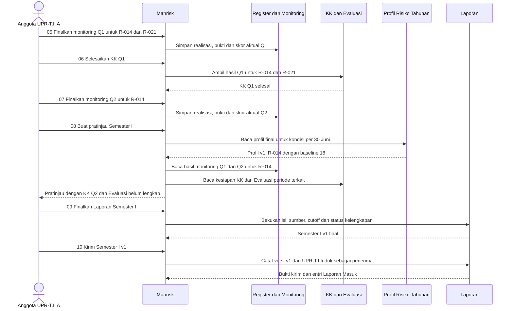
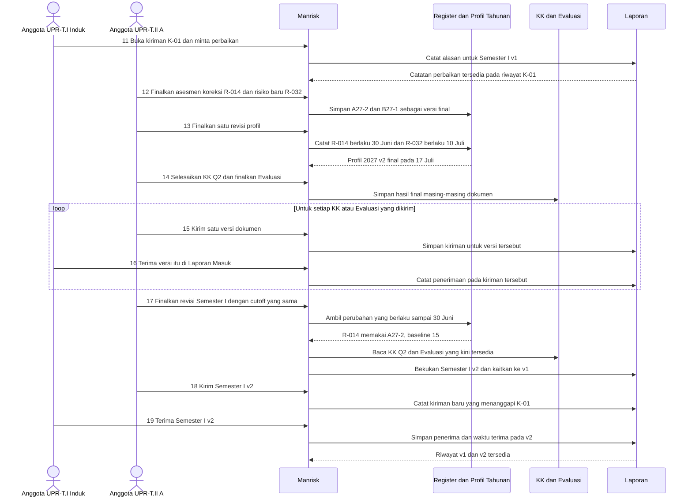
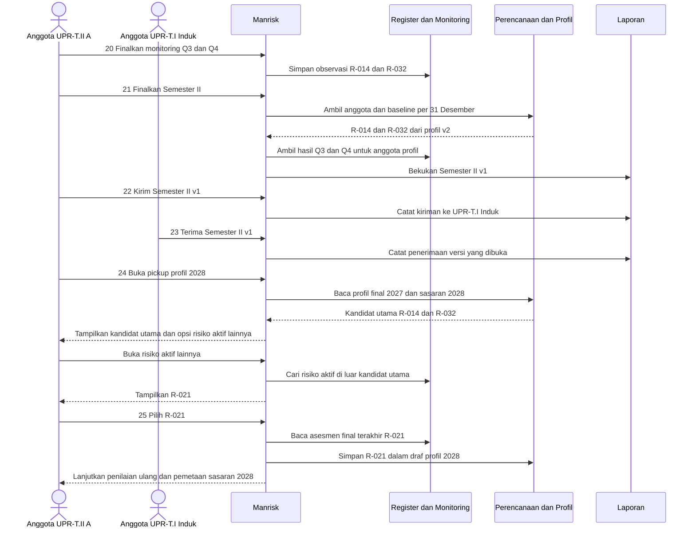

# UML sequence dan aliran data siklus risiko UPR

Contoh rancangan Manrisk untuk siklus 2027, dari pickup risiko oleh UPR-T.II hingga penerimaan dokumen oleh UPR-T.I, dengan pickup awal 2028 sebagai penutup. Empat diagram di bawah membagi satu urutan. Nomor pesan pada diagram merujuk ke baris aliran data di bawahnya. Nama data dan ID bersifat ilustratif.

**UPR-T.II A** adalah unit pelapor dan **UPR-T.I Induk** adalah penerimanya. Pada awal 2027, Perencanaan memuat sasaran `S-01` dan `S-02`. Register memiliki dua risiko final aktif dari 2026.

| Risiko | Perjalanan pada contoh |
| --- | --- |
| `R-014` · Keterlambatan validasi data | Dipilih untuk profil 2027. Skor baseline tampilan awal 18. Bukti per 30 Juni mengoreksi baseline menjadi 15. |
| `R-021` · Ketergantungan pada satu petugas | Dilewati saat pickup 2027. Tetap aktif dan dipantau pada Q1. Dipilih untuk profil 2028 dari daftar risiko aktif lainnya. |
| `R-032` · Gangguan sinkronisasi sistem baru | Muncul 10 Juli 2027. Masuk profil melalui revisi Juli dan dilaporkan pada Semester II. |

Manrisk sudah memiliki Perencanaan, riwayat versi risiko, monitoring per triwulan, KK Pemantauan dan Reviu, serta Evaluasi. Rancangan ini menambahkan keanggotaan Profil Risiko Tahunan, seleksi data laporan berdasarkan tanggal berlaku, dan pengiriman versi dokumen melalui menu **Laporan**. Laporan Risiko dan Tanda tangan merupakan menu yang sudah tersedia. [Navigasi saat ini](../../frontend/src/lib/app-navigation.ts) · [Gap analysis awal](../kmk-1354-gap-analysis-manris-v2.md)

## 1. Januari 2027 · Pickup dan finalisasi profil

| Aksi | Data masuk dan sumber baca | Data yang disimpan dan hasil |
| --- | --- | --- |
| **01 · Buka pickup** | Organisasi aktif, tahun 2027, sasaran dari Perencanaan, profil final 2026 dan versi risiko dari Register. | Menampilkan kandidat dan sumbernya. Jika belum ada profil final 2026, kandidat awal berasal dari Register final aktif pada akhir 2026. |
| **02 · Pilih risiko** | Kode `R-014` dan ID versi sumber dari 2026. | Draf profil 2027 menyimpan pilihan, identitas risiko dalam unit, dan referensi versi sumber. `R-021` tetap aktif di Register dan berada di luar profil 2027. |
| **03 · Nilai ulang dan finalkan risiko** | Asesmen final terakhir sebagai isian awal, sasaran `S-01`, hasil penilaian yang dikonfirmasi, serta rencana yang berlaku pada 2027. | Versi risiko final `A27-1` dengan baseline 18, kode dan identitas risiko yang sama, serta tautan ke versi pendahulu. Draf profil menunjuk versi final ini. |
| **04 · Finalisasi profil** | Draf profil, versi risiko final, sasaran 2027, dan rencana mitigasi yang berlaku. | Profil 2027 v1 membekukan `R-014 → A27-1 → S-01`, baseline, rencana dan pelaku serta waktu finalisasi. `S-02` boleh kosong. Penetapan memakai aksi finalisasi langsung. |

## 2. Maret–Juli 2027 · Monitoring, KK, dan kirim Semester I

| Aksi | Data masuk dan sumber baca | Data yang disimpan dan hasil |
| --- | --- | --- |
| **05 · Monitoring Q1** | Risiko dari Register, triwulan, versi risiko sumber, realisasi dan bukti mitigasi, hasil observasi serta skor aktual. | Monitoring final Q1 untuk `R-014` dan `R-021`. Baseline profil tetap diambil dari profil final. |
| **06 · Selesaikan KK Q1** | Daftar risiko yang benar-benar dipantau pada Q1 dan referensi hasil monitoringnya. | KK Q1 berstatus **Selesai** dengan `R-014` dan `R-021`. |
| **07 · Monitoring Q2** | Versi risiko sumber `R-014`, triwulan Q2, realisasi, bukti, dan hasil observasi. | Monitoring Q2 final dengan skor aktual 12. KK Q2 masih draf. |
| **08 · Pratinjau Semester I** | Unit, tahun, semester dan cutoff 30 Juni. Baca profil final yang memenuhi cutoff, hasil monitoring per anggota profil, serta kelengkapan KK dan Evaluasi. | Pratinjau memuat `R-014` dengan baseline 18 dan aktual Q2 sebesar 12. `R-021` tetap terlihat pada KK Q1 dan berada di luar daftar risiko Semester I. Bagian KK Q2 dan Evaluasi ditandai belum lengkap. |
| **09 · Finalisasi Semester I** | Data pratinjau, versi profil final, referensi monitoring, sumber KK/Evaluasi yang tersedia, serta bagian yang belum lengkap. | Pada 3 Juli, Manrisk membekukan isi **Semester I v1**, termasuk cutoff, sumber, status kelengkapan, dan waktu finalisasi. Draf dapat dibuat sebelum ada profil final. Finalisasi laporan menunggu profil final yang dapat merekam kondisi pada cutoff. |
| **10 · Kirim Semester I v1** | ID versi dokumen final, pengguna pengirim, organisasi pengirim, dan induk UPR-T.I dari hierarki organisasi. | Kiriman `K-01` menyimpan **Semester I v1**, kedua organisasi, pengirim, waktu kirim, dan status **Terkirim**. Anggota UPR-T.I melihatnya di **Laporan → Laporan Masuk**. |

Pratinjau memakai profil final yang berlaku pada cutoff sebagai pilihan awal. Versi yang difinalisasi setelah cutoff dapat dipakai untuk koreksi periode sebelumnya dengan mencatat alasan dan periode yang dikoreksi. Jika profil pertama baru final pada Juli, pratinjau Semester I dapat memakai isi profil yang merekam kondisi per 30 Juni. Manrisk menyimpan 30 Juni sebagai cutoff dan tanggal sebenarnya sebagai waktu finalisasi profil. Perubahan yang berlaku mulai Juli masuk ke Semester II.

## 3. Juli 2027 · Permintaan perbaikan, revisi profil, dan pengiriman ulang

| Aksi | Data masuk dan sumber baca | Data yang disimpan dan hasil |
| --- | --- | --- |
| **11 · Minta perbaikan** | Kiriman `K-01`, keanggotaan pengguna pada UPR-T.I penerima, dan catatan “Skor baseline R-014 perlu disesuaikan dengan bukti per 30 Juni.” | Aksi **Perlu perbaikan** pada kiriman v1, dengan catatan, pelaku dan waktu. UPR-T.II bisa membuka catatan serta dokumen yang dikomentari. |
| **12 · Finalkan asesmen koreksi dan risiko baru** | Bukti per 30 Juni untuk `R-014` dan asesmen awal `R-032` yang muncul 10 Juli. | `A27-2` mencatat baseline 15 dengan identitas `R-014` yang sama. `B27-1` menjadi versi final pertama `R-032`. Risiko yang sudah final dapat dimitigasi dan dipantau sambil menunggu revisi profil. |
| **13 · Finalisasi revisi profil** | Profil v1, dua versi risiko final, sasaran `S-01` untuk `R-014` dan `S-02` untuk `R-032`, serta alasan dan tanggal berlaku per perubahan. | Profil 2027 v2 final pada **17 Juli**. Koreksi `R-014 → A27-2` berlaku **30 Juni**, dengan alasan dan bukti koreksi. Penambahan `R-032 → B27-1` berlaku **10 Juli**. Profil v1 tetap bisa dibuka. |
| **14 · Selesaikan KK Q2 dan finalkan Evaluasi** | Hasil monitoring Q2, isi Evaluasi untuk periode terkait, serta data penyelesaian dokumen masing-masing. | KK Q2 **Selesai** dan Evaluasi **Final**. Masing-masing dapat dirujuk lewat versi yang isinya bisa dibuka kembali. |
| **15 · Kirim KK atau Evaluasi** | Versi KK Q1/Q2 yang **Selesai** atau Evaluasi yang **Final**, pengguna pengirim dan UPR-T.I induk. | Satu kiriman per versi dokumen. Contoh ini menghasilkan tiga kiriman yang dapat dibuka masing-masing di Laporan Masuk. |
| **16 · Terima KK atau Evaluasi** | ID kiriman dokumen yang dibuka dan keanggotaan pengguna pada UPR-T.I penerima. | Setiap penerimaan tercatat pada kiriman dan versi dokumennya, dengan pelaku dan waktu. Laporan Semester I mempunyai riwayat tindakan sendiri. |
| **17 · Finalisasi revisi Semester I** | Cutoff **30 Juni**, Semester I v1, referensi profil v2 dan perubahan yang memenuhi cutoff, aktual Q2, serta KK Q2 dan Evaluasi yang sudah tersedia untuk periode tersebut. | **Semester I v2** merekam alasan revisi, versi `A27-2`, baseline 15, dan aktual Q2 sebesar 12. `R-032` memiliki tanggal berlaku setelah cutoff dan akan muncul di Semester II. Versi laporan juga membekukan sumber pendukung yang dipakai kali ini. |
| **18 · Kirim Semester I v2** | ID versi laporan baru, kiriman sebelumnya, dan UPR-T.I induk. | Kiriman `K-02` dengan status **Terkirim**, terkait `K-01`. Dokumen dan catatan perbaikan pada `K-01` tetap bisa dibuka. |
| **19 · Terima Semester I v2** | Kiriman `K-02` dan keanggotaan pengguna pada UPR-T.I penerima. | **Diterima** tercatat pada kiriman v2 beserta pelaku dan waktunya. Siapa pun di organisasi UPR-T.I penerima dapat menerima atau meminta perbaikan. |

## 4. Desember 2027–Januari 2028 · Tutup semester dan mulai pickup lagi

| Aksi | Data masuk dan sumber baca | Data yang disimpan dan hasil |
| --- | --- | --- |
| **20 · Monitoring Q3 dan Q4** | Risiko final, versi sumber, periode, realisasi, bukti dan skor aktual. | Monitoring final Q3 dan Q4 untuk `R-014` dan `R-032`. Referensi hasil ini tersedia saat menyiapkan Semester II. |
| **21 · Finalisasi Semester II** | Cutoff 31 Desember, profil final yang berlaku, monitoring Q3–Q4, KK dan Evaluasi periode terkait yang tersedia. | **Semester II v1** membekukan `R-014` dan `R-032`, dengan baseline dan aktual terpisah, serta sumber yang dipakai. |
| **22 · Kirim Semester II** | Semester II v1 final, pengguna pengirim dan UPR-T.I induk. | Kiriman **Terkirim** dan entri Laporan Masuk menunjuk versi yang sama. |
| **23 · Terima Semester II** | Kiriman Semester II v1 dan pengguna dari organisasi penerima. | Penerimaan melekat pada versi Semester II yang dikirim, dengan pelaku dan waktu. |
| **24 · Buka pickup untuk 2028** | Profil final 2027 dan sasaran dari Perencanaan 2028. | Pilihan utama memuat `R-014` dan `R-032`. |
| **25 · Pilih risiko aktif lainnya** | Daftar risiko aktif dari Register, termasuk `R-021` yang absen dari profil 2027, serta versi final terakhirnya. | Draf 2028 menyimpan identitas dan versi sumber `R-021`. Pengguna menilai ulang dan mengaitkannya ke sasaran 2028 sebelum finalisasi profil. |

## Referensi data untuk penelusuran

| Catatan | Data yang perlu bisa ditelusuri |
| --- | --- |
| **Versi risiko** | UPR pemilik, identitas risiko dalam UPR, kode, ID versi final, versi pendahulu, sasaran, skor dan rencana terkait. |
| **Versi profil** | UPR dan tahun, nomor serta versi pendahulu, anggota profil, versi asesmen dan rencana yang dibekukan, tanggal berlaku per perubahan, alasan koreksi, pelaku dan waktu finalisasi. |
| **Versi dokumen** | Jenis, UPR, periode, nomor versi, isi yang dibekukan, status akhir, sumber yang tepat, dan waktu finalisasi. Untuk Laporan Semester, simpan cutoff dan daftar versi data yang benar-benar dipakai. Untuk KK dan Evaluasi yang dikirim, penerima harus bisa membuka isi persis versi kirim, termasuk jika dokumen sumber dibuka lagi. |
| **Kiriman dan riwayat tindakan** | ID versi dokumen, organisasi pengirim dan penerima, pengguna pengirim, waktu kirim, kaitan ke kiriman sebelumnya jika ada, serta pelaku, waktu dan catatan terima atau minta perbaikan. |

Untuk Semester I, referensi **Profil v2** saja belum cukup untuk menjelaskan isi laporan. Simpan juga anggota dan versi asesmen yang benar-benar dipakai agar `A27-2` bisa ditelusuri dan penambahan `B27-1` dapat dilaporkan pada periode yang tepat. Simpan tanggal berlaku dan waktu finalisasi secara terpisah agar koreksi masa lalu tetap bisa diaudit.

Sumber teknis untuk mencocokkan rancangan dengan aplikasi saat ini. [Riwayat versi risiko](../../backend/internal/domain/entity/risk.go) · [Monitoring per risiko](../../backend/internal/domain/entity/risk_monitoring.go) · [Snapshot KK](../../backend/internal/domain/entity/working_paper_signing_snapshot.go) · [Evaluasi dapat dibuka ulang](../../backend/internal/usecase/evaluation/reopen.go)

## Implementasi dan verifikasi

Migrasi 83 menyimpan versi profil pada annual_risk_profile_versions dan anggotanya pada annual_risk_profile_members. Dokumen final disimpan pada upr_report_versions, sedangkan pengiriman dan penyelesaiannya disimpan pada upr_report_deliveries. Laporan Semester membekukan baseline, aktual, serta isi dokumen pendukung yang dipakai. Pengiriman KK dan Evaluasi juga menyimpan isi sumber dalam versi dokumen tersendiri.

Hasil pengujian, cakupan fixture, dan cara mengulang siklus tersedia pada [catatan verifikasi](2026-11-12-upr-workflow-verification.md).
